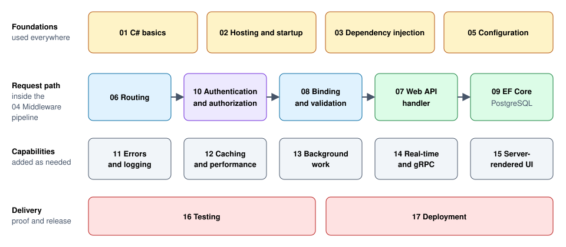

# ASP.NET Core Overview

The map of this section: what ASP.NET Core is, how its 17 topics fit together, what to read first, and how each topic compares with Django.

Author

Benedict Thekkel

**ASP.NET Core** is the web framework of the .NET platform. It fills the same role as Django or FastAPI. You use it to build REST APIs, real-time services and server-rendered sites, and it runs on Linux, Windows and macOS.

This page is the starting point for the section. Each topic has its own notebook, and this page shows how they connect. For the platform underneath, such as the runtime, versions and the `dotnet` tool, read the [.NET Overview](../ASP.NET/dotnet_overview.llms.md).

> **NOTE:**
>
> The code on this page has not been compiled or run yet. It targets .NET 11 and C# 15.

------------------------------------------------------------------------

## 1. ASP.NET Core and the Older ASP.NET

Two products share the ASP.NET name. Learn ASP.NET Core, and treat the older product as something you only maintain.

| Topic | ASP.NET Core | ASP.NET on .NET Framework |
|----|----|----|
| Operating systems | Linux, Windows, macOS | Windows only |
| Server | Kestrel, in your process | IIS |
| Startup file | `Program.cs` | `Global.asax` and `web.config` |
| UI models | Razor Pages, MVC, Blazor | Web Forms, MVC 5 |
| New features | Yes, with a new major version each year | Maintenance only |
| Use it for | All new work | Existing applications |

------------------------------------------------------------------------

## 2. How the Topics Fit Together



The foundations support a request path of routing, authentication, binding, handler and database, with optional capabilities and a delivery layer of testing and deployment

The numbers in the diagram are the notebook numbers. The section has four layers:

1.  **Foundations** are the language and the startup model. Every other page depends on them.
2.  **The request path** is what happens to each HTTP request, from the first middleware component to the database.
3.  **Capabilities** are features that you add when a service needs them.
4.  **Delivery** proves that the service works and puts it into production.

------------------------------------------------------------------------

## 3. One Program.cs, Every Topic

A small service shows where each topic appears in the code. The comments give the notebook number for each line.

``` csharp
using Microsoft.AspNetCore.Authentication.JwtBearer;
using Microsoft.EntityFrameworkCore;

var builder = WebApplication.CreateBuilder(args);                  // 02 Hosting

// Phase 1: register services
builder.Services.AddDbContext<AppDbContext>(options =>             // 09 EF Core
    options.UseNpgsql(builder.Configuration                        // 05 Configuration
        .GetConnectionString("Default")));

builder.Services.AddScoped<ItemService>();                         // 03 Dependency injection
builder.Services.AddValidation();                                  // 08 Validation
builder.Services.AddOpenApi();                                     // 07 Web APIs
builder.Services.AddProblemDetails();                              // 11 Errors
builder.Services.AddHybridCache();                                 // 12 Caching
builder.Services.AddHostedService<CleanupWorker>();                // 13 Background work
builder.Services.AddHealthChecks();                                // 17 Deployment

builder.Services
    .AddAuthentication(JwtBearerDefaults.AuthenticationScheme)     // 10 Authentication
    .AddJwtBearer();
builder.Services.AddAuthorization();                               // 10 Authorization

var app = builder.Build();

// Phase 2: build the request pipeline
app.UseExceptionHandler();                                         // 04 Middleware, 11 Errors
app.UseAuthentication();                                           // 04 Middleware, 10 Authentication
app.UseAuthorization();                                            // 04 Middleware, 10 Authorization

// Phase 3: map the endpoints
app.MapOpenApi();                                                  // 07 Web APIs
app.MapHealthChecks("/health/live");                               // 17 Deployment

var items = app.MapGroup("/api/items").RequireAuthorization();     // 06 Routing

items.MapGet("/{id:int}", async (                                  // 07 Web APIs
    int id,                                                        // 08 Binding
    ItemService service,                                           // 03 Dependency injection
    CancellationToken ct) =>                                       // 01 C# basics
    await service.FindAsync(id, ct) is { } item
        ? Results.Ok(item)
        : Results.NotFound());

app.Run();
```

Read the file from top to bottom. Services come first, middleware comes next, and endpoints come last. Most ASP.NET Core applications keep this shape, however large they become.

------------------------------------------------------------------------

## 4. Contents

Each page ends with a comparison or a table of common mistakes, so you can also use the pages as reference.

| \# | Page | What you learn | Closest Django concept |
|----|----|----|----|
| 01 | [C# and .NET Basics](../ASP.NET/csharp_basics.llms.md) | Nullability, records, LINQ and async | Python |
| 02 | [Hosting and Startup](../ASP.NET/hosting_and_startup.llms.md) | `Program.cs`, Kestrel and shutdown | `asgi.py`, Gunicorn |
| 03 | [Dependency Injection](../ASP.NET/dependency_injection.llms.md) | Service lifetimes and the captive dependency bug | No direct equivalent |
| 04 | [Middleware Pipeline](../ASP.NET/middleware.llms.md) | Component order and custom middleware | `MIDDLEWARE` |
| 05 | [Configuration](../ASP.NET/configuration.llms.md) | Layered settings, options and secrets | `settings.py` |
| 06 | [Routing](../ASP.NET/routing.llms.md) | Templates, constraints and groups | `urls.py` |
| 07 | [Web APIs](../ASP.NET/web_apis.llms.md) | Minimal APIs, controllers and OpenAPI | DRF views |
| 08 | [Model Binding and Validation](../ASP.NET/model_binding_and_validation.llms.md) | Request records and validation rules | DRF serializers |
| 09 | [Entity Framework Core](../ASP.NET/ef_core.llms.md) | Queries, change tracking and migrations | Django ORM |
| 10 | [Authentication and Authorization](../ASP.NET/authentication_and_authorization.llms.md) | JWT, cookies, Identity and policies | `django.contrib.auth`, DRF permissions |
| 11 | [Error Handling and Logging](../ASP.NET/errors_and_logging.llms.md) | Problem Details and OpenTelemetry | DRF exception handler, `logging` |
| 12 | [Caching and Performance](../ASP.NET/caching_and_performance.llms.md) | HybridCache, output cache and rate limits | Cache framework, DRF throttling |
| 13 | [Background Work](../ASP.NET/background_work.llms.md) | Hosted services and Hangfire | Celery |
| 14 | [Real-Time and Service Calls](../ASP.NET/realtime_and_grpc.llms.md) | SSE, SignalR, WebSockets and gRPC | Django Channels |
| 15 | [Server-Rendered UI](../ASP.NET/server_rendered_ui.llms.md) | Razor, Blazor and hosting React | Django templates |
| 16 | [Testing](../ASP.NET/testing.llms.md) | xUnit, `WebApplicationFactory` and Testcontainers | pytest-django |
| 17 | [Deployment](../ASP.NET/deployment.llms.md) | Docker, health checks and CI/CD | Docker, Nginx, GitHub Actions |

------------------------------------------------------------------------

## 5. Choose a Reading Path

Read the pages in number order for full coverage. Use one of these shorter paths when you have a specific goal.

| Goal | Read these pages, in order |
|----|----|
| Build a REST API for a React front end | 01, 02, 03, 04, 05, 06, 07, 08, 09, 10, 11, 16 |
| Read an existing .NET codebase | 01, 02, 03, 04, 07, 09, 15 |
| Prepare for a .NET backend interview | 01, 03, 04, 09, 10, 12, 13, 16 |
| Move a Django service to production on .NET | 05, 11, 12, 16, 17 |

------------------------------------------------------------------------

## 6. What Changes When You Come From Django

Most ideas transfer directly. These five differences need the most attention.

| Difference | In Django | In ASP.NET Core | Read |
|----|----|----|----|
| Wiring | Import what you need | The container supplies each dependency | [03](../ASP.NET/dependency_injection.llms.md) |
| Saving data | `item.save()` on each object | `SaveChangesAsync()` writes all tracked changes | [09](../ASP.NET/ef_core.llms.md) |
| Related data | Lazy loading runs extra queries | Unloaded relations stay empty | [09](../ASP.NET/ef_core.llms.md) |
| Concurrency | Several worker processes | One process with a shared thread pool | [02](../ASP.NET/hosting_and_startup.llms.md) |
| Included features | Admin, ORM and auth in the box | Smaller core, with packages added by you | [07](../ASP.NET/web_apis.llms.md) |

ASP.NET Core has no equivalent of the Django admin. Plan for that cost if your project depends on one.

------------------------------------------------------------------------

## 7. A First Project in Five Milestones

Build one small items API from end to end. Each milestone leaves a working service and has a check that you can measure.

| Milestone | Build | Pages | Done when |
|----|----|----|----|
| 1\. Running API | `GET /health` and in-memory items | 01, 02, 06, 07 | `curl` returns `200` from each endpoint |
| 2\. Real data | PostgreSQL, EF Core and migrations | 03, 05, 09 | Items survive a restart |
| 3\. Safe input | Validation, Problem Details and JWT | 04, 08, 10, 11 | Bad input returns `400`, and no token returns `401` |
| 4\. Proof | Integration tests with Testcontainers | 16 | `dotnet test` passes against real PostgreSQL |
| 5\. Release | Docker image, health checks and CI | 12, 17 | The image starts and `/health/live` returns `200` |

Pages 13, 14 and 15 are optional for this project. Add them when the service needs background jobs, live updates or server-rendered pages.

------------------------------------------------------------------------

## 8. Not Covered Here

- **.NET Aspire**, the orchestration tooling for local multi-service development.
- **MAUI and desktop UI**, because this section is about web services.
- **Azure-specific hosting**. The deployment page uses Docker and AWS.
- **Message brokers in depth**. RabbitMQ and SQS appear only as options on the background work page.

------------------------------------------------------------------------

Back to top
