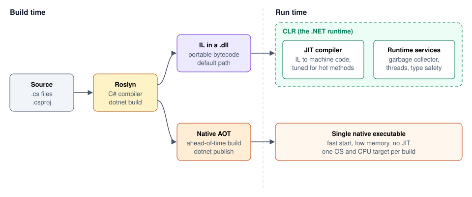
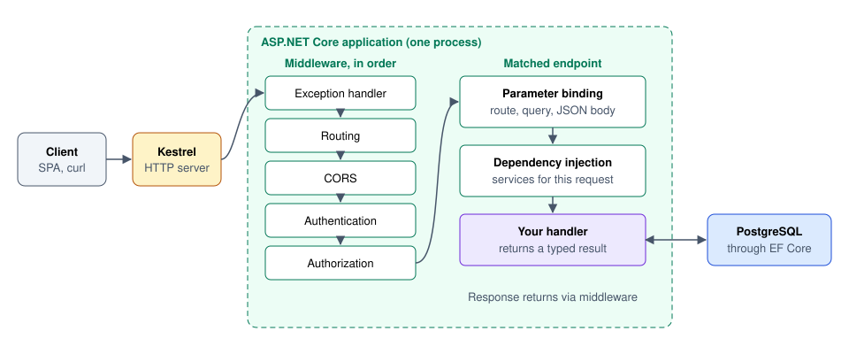

# .NET Overview

What .NET is, how C# code builds and runs, which version to use, and how a small ASP.NET Core API fits together, explained from a Python and Django background.

Author

Benedict Thekkel

**.NET** is a free, open-source platform from Microsoft for building servers, command-line tools, desktop apps and more. It runs on Linux, Windows and macOS. **C#** is its main language. **ASP.NET Core** is its web framework, and it fills the same role as Django or FastAPI.

The main difference from Python is the compile step. The compiler checks every type before the program starts, and the runtime turns the code into machine code. Your API can also use every CPU core from one process, because .NET has no Global Interpreter Lock. The cost is more project structure and a slower edit and run loop than a Python script.

> **NOTE:**
>
> The code on this page has not been compiled or run yet. The version numbers come from Microsoft’s release metadata, read on 2026-11-18.

------------------------------------------------------------------------

## 1. The Names

The naming is confusing because Microsoft reused the word “.NET”. Learn these terms first.

| Term | What it is | Nearest Python equivalent |
|----|----|----|
| **.NET** (5 and later) | The current cross-platform platform | CPython plus the standard library |
| **.NET Core** | The old name for .NET, up to version 3.1 | Not applicable |
| **.NET Framework** | The older Windows-only platform, ending at 4.8.1. Use it only to maintain existing apps | Python 2 is the closest comparison |
| **C#** | The main language. F# and Visual Basic also run on .NET | The Python language |
| **CLR** (Common Language Runtime) | Runs the program: compiles code, collects garbage, schedules threads | The CPython interpreter |
| **IL** (Intermediate Language) | The portable bytecode that the C# compiler produces | `.pyc` bytecode |
| **JIT** (just-in-time compiler) | Turns IL into machine code while the program runs | The CPython 3.13+ experimental JIT |
| **BCL** (Base Class Library) | The built-in collections, IO, JSON, HTTP and crypto types | The standard library |
| **SDK** | The compiler, the `dotnet` command and the runtime. Install it to develop | `uv` plus Python |
| **ASP.NET Core** | The web framework | Django or FastAPI |
| **Kestrel** | The HTTP server built into ASP.NET Core | Uvicorn or Gunicorn |
| **EF Core** (Entity Framework Core) | The ORM and migration tool | Django ORM, or SQLAlchemy with Alembic |
| **NuGet** | The package registry and package format | PyPI and wheels |

------------------------------------------------------------------------

## 2. How Code Builds and Runs



C# source compiles to IL and runs on the CLR, or compiles ahead of time to a native executable

1.  The **Roslyn** compiler reads your `.cs` files and checks all types.
2.  By default, Roslyn writes **IL** into a `.dll` file. This file is not machine code yet.
3.  At startup, the **CLR** loads the `.dll`.
4.  The **JIT** compiles each method to machine code when the method is first called.
5.  The JIT compiles frequently called methods again with stronger optimisation. This is called *tiered compilation*.

**Native AOT** (ahead-of-time compilation) is the second path. It compiles the whole app to one native executable at publish time. Startup is faster and memory use is lower, which suits small containers and serverless functions. The limit is reflection: code that discovers types at run time may not work, so check that each library supports Native AOT before you choose it. Use the JIT path for a normal long-running API.

------------------------------------------------------------------------

## 3. Versions and Support

A new major version ships every November. Even numbers are **LTS** (Long Term Support) and odd numbers are **STS** (Standard Term Support).

| Version | Type | C#  | Latest runtime | Latest SDK | Status on 2026-11-18 | Support ends |
|---------|------|-----|----------------|------------|----------------------|--------------|
| .NET 11 | STS  | 15  | 11.0.0         | 11.0.100   | Active               | 2028-11-14   |
| .NET 10 | LTS  | 14  | 10.0.15        | 10.0.404   | Active               | 2028-11-14   |
| .NET 9  | STS  | 13  | 9.0.23         | 9.0.321    | End of life          | 2026-11-10   |
| .NET 8  | LTS  | 12  | 8.0.34         | 8.0.428    | End of life          | 2026-11-10   |

**Use .NET 11 for a new service, unless a dependency does not support it yet.** .NET 10 and .NET 11 lose support on the same day, so the LTS label gives .NET 10 no extra time here. Use .NET 10 if a required library lags behind. Move any app on .NET 8 or 9 now, because those versions no longer receive security patches.

Pin the SDK for a repository with `global.json`, in the same way `.python-version` pins Python:

``` json
{
  "sdk": {
    "version": "11.0.100",
    "rollForward": "latestFeature"
  }
}
```

------------------------------------------------------------------------

## 4. Install and Tooling

Microsoft’s install script works without `sudo`. It installs the SDK into `~/.dotnet`.

``` bash
curl -sSL https://dot.net/v1/dotnet-install.sh -o dotnet-install.sh
bash dotnet-install.sh --channel 11.0

export DOTNET_ROOT="$HOME/.dotnet"
export PATH="$DOTNET_ROOT:$DOTNET_ROOT/tools:$PATH"
dotnet --info
```

The `dotnet` command does the work of several Python tools:

| Task | Python | .NET |
|----|----|----|
| Create a project | `uv init` | `dotnet new web -n ItemsApi` |
| Add a dependency | `uv add httpx` | `dotnet add package Polly` |
| Install dependencies | `uv sync` | `dotnet restore` |
| Run the app | `uv run python main.py` | `dotnet run` |
| Reload on change | `uvicorn --reload` | `dotnet watch` |
| Run tests | `pytest` | `dotnet test` |
| Format code | `ruff format` | `dotnet format` |
| Create migrations | `manage.py makemigrations` | `dotnet ef migrations add AddItems` |
| Apply migrations | `manage.py migrate` | `dotnet ef database update` |
| Project file | `pyproject.toml` | `ItemsApi.csproj` |
| Lock file | `uv.lock` | `packages.lock.json`, after you set `RestorePackagesWithLockFile` |

There is no virtual environment. NuGet keeps one shared package cache in `~/.nuget/packages`, and each project file states exactly which versions it uses.

------------------------------------------------------------------------

## 5. Project Layout

A **project** (`.csproj`) builds one output. A **solution** (`.slnx`, or the older `.sln`) groups related projects. Keep the web layer, the business logic and the tests in separate projects when the service grows. Start with one web project and one test project.

    ItemsService/
      ItemsService.slnx
      global.json
      Directory.Packages.props       # one place for all NuGet versions
      src/
        ItemsApi/
          ItemsApi.csproj
          Program.cs                 # startup: services, middleware, routes
          appsettings.json           # default configuration
          appsettings.Development.json
          Items/
            ItemEndpoints.cs         # routes, thin
            ItemService.cs           # business logic
            Item.cs                  # entity
          Data/
            AppDbContext.cs          # EF Core session and table sets
            Migrations/
      tests/
        ItemsApi.Tests/
          ItemsApi.Tests.csproj

The project file is short, because the SDK supplies the defaults. It includes every `.cs` file under the folder automatically.

``` xml
<Project Sdk="Microsoft.NET.Sdk.Web">
  <PropertyGroup>
    <TargetFramework>net11.0</TargetFramework>
    <Nullable>enable</Nullable>
    <ImplicitUsings>enable</ImplicitUsings>
    <TreatWarningsAsErrors>true</TreatWarningsAsErrors>
  </PropertyGroup>
</Project>
```

`TargetFramework` selects the .NET version. `Nullable` makes the compiler warn when a value can be `null`. `TreatWarningsAsErrors` turns those warnings into build failures, so a missing null check cannot reach production.

------------------------------------------------------------------------

## 6. C# for a Python Developer

Most concepts carry over. The syntax and the strictness change.

| Concept | Python | C# |
|----|----|----|
| Variable | `count = 3` | `var count = 3;` (the type is still fixed as `int`) |
| Optional value | `name: Optional[str] = None` | `string? name = null;` |
| List | `[1, 2, 3]` | `List<int> xs = [1, 2, 3];` |
| Dictionary | `{"a": 1}` | `new Dictionary<string, int> { ["a"] = 1 }` |
| Data class | `@dataclass(frozen=True)` | `record Item(int Id, string Name);` |
| Interface | `typing.Protocol` | `interface IItemStore { }` |
| Comprehension | `[x.name for x in xs if x.ok]` | `xs.Where(x => x.Ok).Select(x => x.Name).ToList()` |
| String format | `f"id={item.id}"` | `$"id={item.Id}"` |
| Async function | `async def get() -> Item:` | `async Task<Item> GetAsync()` |
| Context manager | `with open(path) as f:` | `using var f = File.OpenRead(path);` |
| Pattern match | `match value:` | `value switch { ... }` |
| Decorator | `@app.get("/")` | No direct equivalent. Attributes such as `[Authorize]` are metadata only |

**LINQ** (Language Integrated Query) is the `Where` and `Select` style in the comprehension row. It is the feature to learn first. The same syntax filters a list in memory, and EF Core translates it to SQL when it runs on a database table.

**Async works differently.** Python runs async code on one event loop in one thread. .NET runs tasks on a pool of threads, so CPU work and async work can run at the same time on all cores.

------------------------------------------------------------------------

## 7. How a Request Moves Through ASP.NET Core



A request passes through Kestrel, ordered middleware, parameter binding and dependency injection, then reaches the handler

1.  **Kestrel** accepts the connection and creates an `HttpContext` object.
2.  **Middleware** runs in the order that `Program.cs` registers it. The order matters: authentication must run before authorization.
3.  **Routing** selects the endpoint from the path and the method.
4.  **Parameter binding** reads the route values, query string and JSON body into typed parameters.
5.  **Dependency injection** supplies the services that the handler asks for.
6.  **Your handler** runs and returns a typed result.
7.  The response travels back through the middleware in reverse order.

Dependency injection is built into the framework. Each service has one of three lifetimes:

| Lifetime       | One instance per | Typical use                    |
|----------------|------------------|--------------------------------|
| `AddSingleton` | Application      | Caches, clients, configuration |
| `AddScoped`    | HTTP request     | `DbContext`, the current user  |
| `AddTransient` | Injection        | Small stateless helpers        |

------------------------------------------------------------------------

## 8. A Small Working API

This API stores items in memory, so it needs no database. Create the project and add the OpenAPI package:

``` bash
dotnet new web -n ItemsApi
cd ItemsApi
dotnet add package Microsoft.AspNetCore.OpenApi
```

Replace `Program.cs` with this file:

``` csharp
using System.Collections.Concurrent;
using Microsoft.AspNetCore.Http.HttpResults;

var builder = WebApplication.CreateBuilder(args);

builder.Services.AddOpenApi();
builder.Services.AddProblemDetails();
builder.Services.AddSingleton<IItemStore, InMemoryItemStore>();

var app = builder.Build();

app.UseExceptionHandler();

if (app.Environment.IsDevelopment())
{
    app.MapOpenApi();
}

app.MapGet("/health", () => TypedResults.Ok(new { status = "ok" }));

var items = app.MapGroup("/items").WithTags("Items");

items.MapGet("/", (IItemStore store) => TypedResults.Ok(store.All()));

items.MapGet("/{id:int}", Results<Ok<Item>, NotFound> (int id, IItemStore store) =>
    store.Find(id) is { } item
        ? TypedResults.Ok(item)
        : TypedResults.NotFound());

items.MapPost("/", Results<Created<Item>, ValidationProblem> (CreateItem body, IItemStore store) =>
{
    if (string.IsNullOrWhiteSpace(body.Name))
    {
        return TypedResults.ValidationProblem(new Dictionary<string, string[]>
        {
            ["name"] = ["Name is required."],
        });
    }

    var item = store.Add(body.Name.Trim());
    return TypedResults.Created($"/items/{item.Id}", item);
});

app.Run();

public record CreateItem(string Name);

public record Item(int Id, string Name);

public interface IItemStore
{
    IReadOnlyList<Item> All();
    Item? Find(int id);
    Item Add(string name);
}

public sealed class InMemoryItemStore : IItemStore
{
    private readonly ConcurrentDictionary<int, Item> _items = new();
    private int _lastId;

    public IReadOnlyList<Item> All() => _items.Values.OrderBy(item => item.Id).ToList();

    public Item? Find(int id) => _items.GetValueOrDefault(id);

    public Item Add(string name)
    {
        var item = new Item(Interlocked.Increment(ref _lastId), name);
        _items[item.Id] = item;
        return item;
    }
}
```

Run it, then call it from a second terminal:

``` bash
dotnet run --urls http://localhost:5000

curl -X POST localhost:5000/items -H 'Content-Type: application/json' -d '{"name":"First"}'
curl localhost:5000/items/1
curl localhost:5000/openapi/v1.json
```

The store is a singleton, so it must be safe when requests arrive on several threads at once. `ConcurrentDictionary` and `Interlocked.Increment` provide that safety. The return type `Results<Ok<Item>, NotFound>` lists every response the handler can send, and the OpenAPI document is generated from it.

------------------------------------------------------------------------

## 9. The Default Stack

One choice per layer, for a service that matches a Django and PostgreSQL deployment.

| Layer | Choice | Why this one |
|----|----|----|
| Runtime | .NET 11 | Newest version, with the same end of support as .NET 10 |
| Web framework | ASP.NET Core Minimal APIs | Least ceremony. Controllers remain a valid choice for large existing teams |
| ORM and migrations | EF Core | The standard option, with LINQ queries and generated migrations |
| PostgreSQL driver | `Npgsql.EntityFrameworkCore.PostgreSQL` | The maintained EF Core provider for PostgreSQL |
| Hand-tuned SQL | Dapper | Thin mapping for the few queries where EF Core output is not good enough |
| Authentication | `Microsoft.AspNetCore.Authentication.JwtBearer` | Validates JWTs from your identity provider |
| Background jobs | `BackgroundService`, then Hangfire | Built-in workers first. Add Hangfire when jobs must survive a restart |
| Cache | `HybridCache` with Redis | Combines in-process and shared cache, and stops many requests rebuilding one key |
| Logs, metrics, traces | `ILogger` and OpenTelemetry | Exports to Grafana, Prometheus and Loki through standard protocols |
| Tests | xUnit, `WebApplicationFactory`, Testcontainers | Runs the real app in memory against a real PostgreSQL container |

------------------------------------------------------------------------

## 10. Configuration and Secrets

ASP.NET Core merges configuration from several sources. A later source overrides an earlier one:

1.  `appsettings.json`
2.  `appsettings.{Environment}.json`
3.  User secrets, in the Development environment only
4.  Environment variables
5.  Command-line arguments

A double underscore in an environment variable stands for one level of nesting. So `ConnectionStrings__Default` sets this value:

``` json
{
  "ConnectionStrings": {
    "Default": "Host=localhost;Database=items"
  }
}
```

The `ASPNETCORE_ENVIRONMENT` variable selects the environment. Keep passwords out of `appsettings.json`. Use `dotnet user-secrets` on a development machine, and environment variables or a secret manager in production.

------------------------------------------------------------------------

## 11. Build and Deploy

`dotnet publish` produces the release output. A multi-stage Dockerfile keeps the SDK out of the final image:

``` dockerfile
FROM mcr.microsoft.com/dotnet/sdk:11.0 AS build
WORKDIR /src
COPY *.csproj ./
RUN dotnet restore
COPY . ./
RUN dotnet publish -c Release -o /app --no-restore

FROM mcr.microsoft.com/dotnet/aspnet:11.0
WORKDIR /app
COPY --from=build /app ./
USER $APP_UID
EXPOSE 8080
ENTRYPOINT ["dotnet", "ItemsApi.dll"]
```

These images listen on port 8080 by default. `APP_UID` is a non-root user that the image defines. Put Nginx, Caddy or a cloud load balancer in front of Kestrel for TLS. One process uses all CPU cores, so you do not need a Gunicorn-style pool of workers.

------------------------------------------------------------------------

## 12. Compared With Django and FastAPI

| Topic | Django with DRF | FastAPI | ASP.NET Core |
|----|----|----|----|
| Type checking | Optional, external | Optional, external, enforced at the API boundary | Enforced by the compiler |
| Concurrency | Worker processes | Event loop, plus worker processes | Thread pool in one process |
| CPU-heavy work | Hand off to Celery | Hand off to Celery | Can run in-process, or in a worker |
| ORM | Built in | SQLAlchemy, added by you | EF Core, added as a package |
| Migrations | Built in | Alembic | EF Core |
| Admin site | Built in | None | None |
| OpenAPI | `drf-spectacular` | Built in | Built in document, UI added separately |
| Deployment artifact | Source plus environment | Source plus environment | Compiled output or native binary |
| ML ecosystem | Excellent | Excellent | Limited, though ONNX Runtime is supported |

**Choose ASP.NET Core** when you need high throughput from few machines, strict compile-time guarantees across a large codebase, or integration with a Microsoft-based organisation. **Stay with Django** when an admin site and fast delivery matter most. **Stay with FastAPI** when the service sits next to Python ML code.

------------------------------------------------------------------------

## 13. Common Mistakes

| Mistake | What goes wrong | Do this instead |
|----|----|----|
| Calling `.Result` or `.Wait()` on a task | Blocks a pool thread, and the server stalls under load | Use `await` through the whole call chain |
| Sharing one `DbContext` across threads | `DbContext` is not thread-safe, so queries fail or corrupt state | Register it as scoped and use one per request |
| Injecting a scoped service into a singleton | The scoped object lives forever and keeps stale state | Inject `IServiceScopeFactory` and create a scope |
| Returning EF Core entities from an API | Exposes internal fields and couples clients to the schema | Return dedicated response records |
| Forgetting `Include` in EF Core | Related data is missing, because lazy loading is off by default | Use `Include` or project with `Select` |
| Registering middleware in the wrong order | Authorization runs without an authenticated user | Follow the order in section 7 |
| Starting new work on .NET Framework | No cross-platform support and no new features | Use the current .NET version |

------------------------------------------------------------------------

## 14. Where to Go Next

| Topic | Why it comes next |
|----|----|
| EF Core with PostgreSQL | Models, LINQ queries, migrations and the N+1 problem |
| Authentication and authorization | JWT validation, policies and resource-based checks |
| Testing | `WebApplicationFactory` and Testcontainers |
| Observability | OpenTelemetry traces and metrics into Grafana |

Official references: [.NET documentation](https://learn.microsoft.com/en-us/dotnet/), [ASP.NET Core documentation](https://learn.microsoft.com/en-us/aspnet/core/), [EF Core documentation](https://learn.microsoft.com/en-us/ef/core/) and the [.NET support policy](https://dotnet.microsoft.com/en-us/platform/support/policy/dotnet-core).

------------------------------------------------------------------------

Back to top
