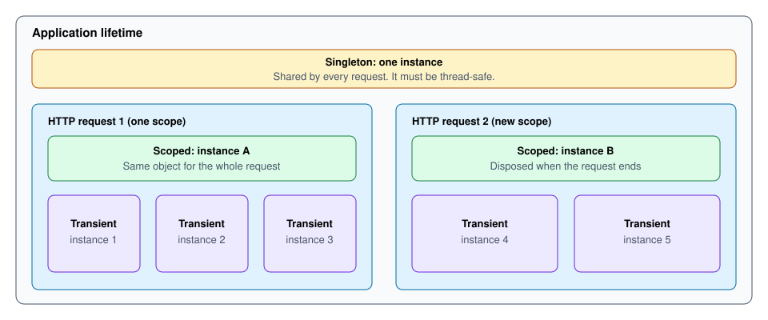

# Dependency Injection

The built-in service container: registering services, the singleton, scoped and transient lifetimes, and the captive dependency bug.

Author

Benedict Thekkel

**Dependency injection** (DI) means that a class declares what it needs, and the framework supplies it. ASP.NET Core is built around one DI container. Django has no direct equivalent, so this is one of the most important new ideas to learn.

> **NOTE:**
>
> The code on this page has not been compiled or run yet. It targets .NET 11 and C# 15.

------------------------------------------------------------------------

## 1. Why It Exists

A class that creates its own dependencies is hard to test and hard to change. A class that receives them through its constructor can run with a fake in a test.

``` csharp
public interface IEmailSender
{
    Task SendAsync(string to, string subject, CancellationToken ct);
}

public sealed class WelcomeService(IEmailSender email)
{
    public Task WelcomeAsync(string address, CancellationToken ct) =>
        email.SendAsync(address, "Welcome", ct);
}
```

`WelcomeService` depends on the interface. It does not know which email provider runs behind it.

------------------------------------------------------------------------

## 2. Register and Consume

Register each service in `Program.cs`:

``` csharp
builder.Services.AddSingleton<IEmailSender, SmtpEmailSender>();
builder.Services.AddScoped<WelcomeService>();
```

Consume a service by naming it as a parameter:

``` csharp
app.MapPost("/welcome", async (string address, WelcomeService service, CancellationToken ct) =>
{
    await service.WelcomeAsync(address, ct);
    return TypedResults.NoContent();
});
```

The container builds the whole graph. It creates `SmtpEmailSender`, passes it to `WelcomeService`, and passes that to the handler.

------------------------------------------------------------------------

## 3. The Three Lifetimes



Singleton services live for the application, scoped services live for one request, and transient services are created for each injection

| Lifetime | Instances | Use it for | Must be thread-safe? |
|----|----|----|----|
| `AddSingleton` | One for the application | Caches, `HttpClient` factories, configuration | Yes |
| `AddScoped` | One per HTTP request | `DbContext`, the current user, a unit of work | Normally no |
| `AddTransient` | One per injection | Small stateless helpers | Normally no |

Choose the lifetime with these questions, in order:

1.  Does the service hold per-request state or a `DbContext`? Use **scoped**.
2.  Is the service expensive to create, and is it thread-safe? Use **singleton**.
3.  Is it small and stateless? Use **transient**.

------------------------------------------------------------------------

## 4. The Captive Dependency Bug

A service must not depend on a service with a shorter lifetime. A singleton that receives a scoped service keeps it for the life of the application. The scoped service becomes **captive**.

``` csharp
// Wrong: one DbContext is shared by every request, on many threads
public sealed class BadCache(AppDbContext db) { }

builder.Services.AddSingleton<BadCache>();
```

| Consumer | Can use singleton | Can use scoped | Can use transient |
|----|----|----|----|
| Singleton | Yes | **No** | Only if the transient is safe to keep for the app lifetime |
| Scoped | Yes | Yes | Yes |
| Transient | Yes | Yes | Yes |

The container checks for this error in the Development environment and throws at startup. Enable the same check in every environment:

``` csharp
builder.Host.UseDefaultServiceProvider(options =>
{
    options.ValidateScopes = true;
    options.ValidateOnBuild = true;
});
```

------------------------------------------------------------------------

## 5. Create a Scope Yourself

A singleton or background worker has no request scope. Create one for each unit of work:

``` csharp
public sealed class ReportWorker(IServiceScopeFactory scopes) : BackgroundService
{
    protected override async Task ExecuteAsync(CancellationToken stoppingToken)
    {
        using var timer = new PeriodicTimer(TimeSpan.FromMinutes(5));

        while (await timer.WaitForNextTickAsync(stoppingToken))
        {
            await using var scope = scopes.CreateAsyncScope();
            var db = scope.ServiceProvider.GetRequiredService<AppDbContext>();
            await db.Items.CountAsync(stoppingToken);
        }
    }
}
```

The `DbContext` is disposed when the scope ends.

------------------------------------------------------------------------

## 6. Registration Patterns

| Pattern | Code |
|----|----|
| Interface to implementation | `services.AddScoped<IStore, SqlStore>();` |
| Concrete class | `services.AddScoped<ItemService>();` |
| Factory | `services.AddSingleton<IClock>(_ => new SystemClock());` |
| Existing instance | `services.AddSingleton(TimeProvider.System);` |
| Register only if absent | `services.TryAddScoped<IStore, SqlStore>();` |

Register several implementations to receive all of them:

``` csharp
builder.Services.AddScoped<INotifier, EmailNotifier>();
builder.Services.AddScoped<INotifier, SmsNotifier>();

public sealed class Broadcast(IEnumerable<INotifier> notifiers) { }
```

**Keyed services** select one implementation by name:

``` csharp
builder.Services.AddKeyedSingleton<IStorage, S3Storage>("s3");
builder.Services.AddKeyedSingleton<IStorage, LocalStorage>("local");

public sealed class Uploads([FromKeyedServices("s3")] IStorage storage) { }
```

------------------------------------------------------------------------

## 7. HttpClient

Do not create a new `HttpClient` for each call, because that can exhaust sockets. Register a typed client through `IHttpClientFactory`:

``` csharp
builder.Services.AddHttpClient<WeatherClient>(client =>
{
    client.BaseAddress = new Uri("https://api.example.com/");
    client.Timeout = TimeSpan.FromSeconds(10);
});

public sealed class WeatherClient(HttpClient http)
{
    public Task<string> TodayAsync(CancellationToken ct) =>
        http.GetStringAsync("today", ct);
}
```

------------------------------------------------------------------------

## 8. Replace a Service in a Test

DI makes integration tests simple. Replace one registration and keep the rest of the app:

``` csharp
factory.WithWebHostBuilder(builder =>
    builder.ConfigureTestServices(services =>
    {
        services.RemoveAll<IEmailSender>();
        services.AddSingleton<IEmailSender, FakeEmailSender>();
    }));
```

------------------------------------------------------------------------

## 9. Compared With Python

| Python                    | ASP.NET Core                                    |
|---------------------------|-------------------------------------------------|
| Module-level instance     | Singleton                                       |
| FastAPI `Depends(get_db)` | Scoped service                                  |
| `unittest.mock.patch`     | Replace the registration                        |
| Django `request.user`     | A scoped service or `ClaimsPrincipal` parameter |

------------------------------------------------------------------------

## 10. Common Mistakes

| Mistake | What goes wrong | Do this instead |
|----|----|----|
| Injecting scoped into singleton | Stale state and thread-safety failures | Use `IServiceScopeFactory` |
| Calling `GetRequiredService` everywhere | Dependencies are hidden | Use constructor injection |
| Forgetting a registration | The app throws when it resolves the service | Keep `ValidateOnBuild` on |
| Adding an interface for every class | Extra code with no benefit | Add one when you need a second implementation or a fake |
| Storing request data in a singleton | Users see each other’s data | Use a scoped service |

------------------------------------------------------------------------

Back to top
