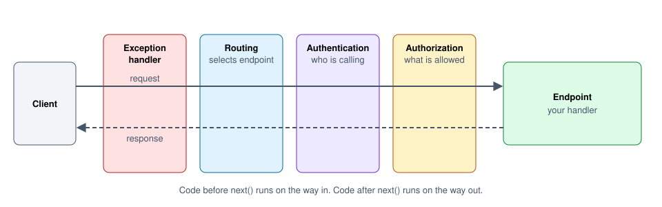

# Middleware Pipeline

How requests pass through ordered middleware, why the order matters, and how to write your own components.

Author

Benedict Thekkel

**Middleware** is a component that handles a request, optionally calls the next component, and can then act on the response. Components form a chain called the **pipeline**. Django has the same concept, so the main new detail is the required order of the built-in components.

> **NOTE:**
>
> The code on this page has not been compiled or run yet. It targets .NET 11 and C# 15.

------------------------------------------------------------------------

## 1. The Mental Model



Requests pass through each middleware in order, reach the endpoint, and the response returns through the same middleware in reverse order

Each component has code before and after the call to `next`:

``` csharp
app.Use(async (context, next) =>
{
    var started = TimeProvider.System.GetTimestamp();

    await next(context);

    var elapsed = TimeProvider.System.GetElapsedTime(started);
    app.Logger.LogInformation("{Path} took {Ms} ms",
        context.Request.Path, elapsed.TotalMilliseconds);
});
```

Code before `next` runs on the way in. Code after `next` runs on the way out.

------------------------------------------------------------------------

## 2. Use, Run and Map

| Method | Behaviour |
|----|----|
| `app.Use` | Runs and can call the next component |
| `app.Run` | Ends the pipeline |
| `app.Map("/path", ...)` | Creates a separate branch for a path prefix |
| `app.MapWhen(predicate, ...)` | Creates a separate branch for a condition |
| `app.UseWhen(predicate, ...)` | Adds a conditional branch that rejoins the main pipeline |

``` csharp
app.UseWhen(
    context => context.Request.Path.StartsWithSegments("/api"),
    branch => branch.UseMiddleware<ApiKeyMiddleware>());
```

A component **short-circuits** the pipeline when it does not call `next`. Authorization does this when it returns `403`.

------------------------------------------------------------------------

## 3. The Required Order

Use this order for a typical API:

``` csharp
var app = builder.Build();

app.UseForwardedHeaders();     // 1. Restore the client IP and scheme behind a proxy
app.UseExceptionHandler();     // 2. Catch failures from everything below
app.UseHsts();                 // 3. Send the HSTS header in production
app.UseHttpsRedirection();     // 4. Redirect HTTP to HTTPS
app.UseRouting();              // 5. Select the endpoint
app.UseCors();                 // 6. Answer cross-origin requests
app.UseAuthentication();       // 7. Identify the caller
app.UseAuthorization();        // 8. Check what the caller may do
app.UseRateLimiter();          // 9. Apply limits that can depend on the user
app.UseOutputCache();          // 10. Serve cached responses

app.MapItems();                // Endpoints
app.Run();
```

| Rule | Reason |
|----|----|
| Exception handler goes early | It only catches exceptions from later components |
| Forwarded headers go first | Later components need the real scheme and client IP |
| Routing goes before CORS and auth | They read metadata from the selected endpoint |
| Authentication goes before authorization | Authorization needs the identity |
| Authorization goes before output cache | Unauthorized callers must not receive cached data |

------------------------------------------------------------------------

## 4. Write a Middleware Class

Use a class for anything larger than a few lines. This example adds a correlation ID to each response and log entry.

``` csharp
public sealed class CorrelationIdMiddleware(
    RequestDelegate next,
    ILogger<CorrelationIdMiddleware> logger)
{
    private const string Header = "X-Correlation-ID";

    public async Task InvokeAsync(HttpContext context)
    {
        var id = context.Request.Headers[Header].FirstOrDefault()
            ?? Guid.NewGuid().ToString("N");

        context.Response.OnStarting(() =>
        {
            context.Response.Headers[Header] = id;
            return Task.CompletedTask;
        });

        using (logger.BeginScope(new Dictionary<string, object> { ["CorrelationId"] = id }))
        {
            await next(context);
        }
    }
}
```

Register it in the pipeline:

``` csharp
app.UseMiddleware<CorrelationIdMiddleware>();
```

------------------------------------------------------------------------

## 5. Middleware and Lifetimes

A convention-based middleware class is created **once**, when the app starts. It behaves like a singleton. Do not inject a scoped service into its constructor. Add the scoped service to `InvokeAsync` instead:

``` csharp
public sealed class TenantMiddleware(RequestDelegate next)
{
    public async Task InvokeAsync(HttpContext context, TenantContext tenant)
    {
        tenant.Id = context.Request.Headers["X-Tenant"].FirstOrDefault();
        await next(context);
    }
}
```

The container resolves `TenantContext` for each request.

------------------------------------------------------------------------

## 6. The Response Has a Start Point

Headers go to the client with the first body bytes. After that point, you cannot change the status code or the headers.

``` csharp
await next(context);

if (!context.Response.HasStarted)
{
    context.Response.Headers["X-Handled"] = "true";
}
```

Use `context.Response.OnStarting` to set a header just before the response starts. The correlation ID example uses this method.

------------------------------------------------------------------------

## 7. Middleware or Endpoint Filter?

| Need                                 | Use             |
|--------------------------------------|-----------------|
| Applies to all requests              | Middleware      |
| Needs the raw request before routing | Middleware      |
| Applies to one endpoint or group     | Endpoint filter |
| Needs the bound handler arguments    | Endpoint filter |

``` csharp
items.MapPost("/", CreateItem)
    .AddEndpointFilter(async (context, next) =>
    {
        var result = await next(context);
        return result;
    });
```

------------------------------------------------------------------------

## 8. Compared With Django

| Django                                      | ASP.NET Core                 |
|---------------------------------------------|------------------------------|
| `MIDDLEWARE` list in settings               | Calls in `Program.cs`        |
| `get_response(request)`                     | `await next(context)`        |
| `process_exception`                         | Exception handler middleware |
| `CorsMiddleware` from `django-cors-headers` | Built-in `UseCors`           |
| Decorator on a view                         | Endpoint filter              |

------------------------------------------------------------------------

## 9. Common Mistakes

| Mistake | What goes wrong | Do this instead |
|----|----|----|
| `UseAuthorization` before `UseAuthentication` | Every user looks anonymous | Follow the order in section 3 |
| Exception handler added late | Earlier failures return an empty 500 | Add it near the top |
| Writing a body and then calling `next` | Later components fail or corrupt the response | Write the body or call `next`, not both |
| Setting headers after `next` | The app throws because the response started | Use `OnStarting` |
| Scoped service in a middleware constructor | Captive dependency | Inject it into `InvokeAsync` |
| Reading the body without buffering | Later components see an empty body | Call `context.Request.EnableBuffering()` |

------------------------------------------------------------------------

Back to top
