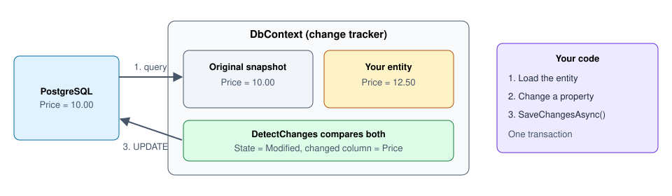

# Entity Framework Core

The .NET ORM with PostgreSQL: DbContext, entities, LINQ queries, change tracking, migrations, transactions and performance.

Author

Benedict Thekkel

**Entity Framework Core** (EF Core) maps C# classes to database tables. It fills the role of the Django ORM, but it works differently in one major way. A `DbContext` tracks loaded objects and writes all changes together when you call `SaveChangesAsync`.

> **NOTE:**
>
> The code on this page has not been compiled or run yet. It targets .NET 11 and C# 15.

------------------------------------------------------------------------

## 1. Setup With PostgreSQL

``` bash
dotnet add package Npgsql.EntityFrameworkCore.PostgreSQL
dotnet add package Microsoft.EntityFrameworkCore.Design
dotnet tool install --global dotnet-ef
```

``` csharp
builder.Services.AddDbContext<AppDbContext>(options =>
    options.UseNpgsql(builder.Configuration.GetConnectionString("Default")));
```

`AddDbContext` registers the context as a **scoped** service, so each request receives its own instance.

------------------------------------------------------------------------

## 2. Entities and DbContext

``` csharp
public sealed class Category
{
    public int Id { get; set; }
    public required string Name { get; set; }
    public List<Item> Items { get; set; } = [];
}

public sealed class Item
{
    public int Id { get; set; }
    public required string Name { get; set; }
    public decimal Price { get; set; }
    public DateTimeOffset CreatedAt { get; set; } = DateTimeOffset.UtcNow;

    public int CategoryId { get; set; }
    public Category Category { get; set; } = null!;
}

public sealed class AppDbContext(DbContextOptions<AppDbContext> options) : DbContext(options)
{
    public DbSet<Item> Items => Set<Item>();
    public DbSet<Category> Categories => Set<Category>();

    protected override void OnModelCreating(ModelBuilder model)
    {
        model.ApplyConfigurationsFromAssembly(typeof(AppDbContext).Assembly);
    }
}
```

Keep the mapping in a configuration class:

``` csharp
using Microsoft.EntityFrameworkCore.Metadata.Builders;

public sealed class ItemConfiguration : IEntityTypeConfiguration<Item>
{
    public void Configure(EntityTypeBuilder<Item> item)
    {
        item.Property(i => i.Name).HasMaxLength(100);
        item.Property(i => i.Price).HasPrecision(12, 2);
        item.HasIndex(i => i.Name).IsUnique();

        item.HasOne(i => i.Category)
            .WithMany(c => c.Items)
            .HasForeignKey(i => i.CategoryId)
            .OnDelete(DeleteBehavior.Restrict);
    }
}
```

------------------------------------------------------------------------

## 3. Migrations

``` bash
dotnet ef migrations add AddItems
dotnet ef database update
dotnet ef migrations script --idempotent -o migrate.sql
dotnet ef migrations bundle -o efbundle
```

| Django           | EF Core                         |
|------------------|---------------------------------|
| `makemigrations` | `dotnet ef migrations add Name` |
| `migrate`        | `dotnet ef database update`     |
| `sqlmigrate`     | `dotnet ef migrations script`   |
| `showmigrations` | `dotnet ef migrations list`     |

Read each generated migration before you apply it. A renamed column can appear as a drop and an add, which loses data. Replace those two operations with `RenameColumn`.

For production, run the idempotent script or the bundle as a deployment step. Do not call `Database.Migrate()` at startup, because several replicas can start at the same time.

------------------------------------------------------------------------

## 4. Query With LINQ

A query runs only when you call a terminal method such as `ToListAsync`.

``` csharp
var items = await db.Items
    .AsNoTracking()
    .Where(i => i.Price > 10m && i.Category.Name == "Office")
    .OrderByDescending(i => i.CreatedAt)
    .Take(20)
    .Select(i => new ItemResponse(i.Id, i.Name, i.Price, i.Category.Name))
    .ToListAsync(ct);
```

| Django ORM | EF Core |
|----|----|
| `Item.objects.filter(price__gt=10)` | `db.Items.Where(i => i.Price > 10)` |
| `.get(pk=1)` | `.SingleAsync(i => i.Id == 1)` |
| `.first()` | `.FirstOrDefaultAsync()` |
| `.exists()` | `.AnyAsync()` |
| `.count()` | `.CountAsync()` |
| `.values("id", "name")` | `.Select(i => new { i.Id, i.Name })` |
| `.select_related("category")` | `.Include(i => i.Category)` |
| `.prefetch_related("items")` | `.Include(c => c.Items).AsSplitQuery()` |
| `.annotate(n=Count("items"))` | `.Select(c => new { c.Name, N = c.Items.Count })` |

------------------------------------------------------------------------

## 5. Change Tracking



Tracked entities are compared with their original values and SaveChangesAsync writes the differences in one transaction

``` csharp
var item = await db.Items.SingleAsync(i => i.Id == id, ct);
item.Price = 12.50m;

db.Items.Add(new Item { Name = "Pen", Price = 2m, CategoryId = 1 });

await db.SaveChangesAsync(ct);
```

`SaveChangesAsync` detects the changed properties and runs the `UPDATE` and `INSERT` in one transaction. There is no `item.save()` call.

| Entity state | `SaveChangesAsync` runs                    |
|--------------|--------------------------------------------|
| `Added`      | `INSERT`                                   |
| `Modified`   | `UPDATE` for the changed columns           |
| `Deleted`    | `DELETE`                                   |
| `Unchanged`  | Nothing                                    |
| `Detached`   | Nothing, because EF Core does not track it |

Use `AsNoTracking` on read-only queries. It uses less memory and runs faster.

------------------------------------------------------------------------

## 6. Bulk Operations

These methods run one SQL statement and skip the change tracker. They are the equivalent of `QuerySet.update()` and `QuerySet.delete()`.

``` csharp
await db.Items
    .Where(i => i.CategoryId == 3)
    .ExecuteUpdateAsync(set => set.SetProperty(i => i.Price, i => i.Price * 1.1m), ct);

await db.Items
    .Where(i => i.CreatedAt < cutoff)
    .ExecuteDeleteAsync(ct);
```

------------------------------------------------------------------------

## 7. Avoid the N+1 Problem

Lazy loading is off by default. A navigation property that you did not load is empty, so a missing `Include` often produces wrong data rather than extra queries.

``` csharp
// Best for APIs: fetch only the columns you need
var rows = await db.Categories
    .AsNoTracking()
    .Select(c => new { c.Name, Items = c.Items.Select(i => i.Name).ToList() })
    .ToListAsync(ct);

// Use Include when you will modify the loaded graph
var category = await db.Categories
    .Include(c => c.Items)
    .AsSplitQuery()
    .SingleAsync(c => c.Id == id, ct);
```

`AsSplitQuery` loads a collection with a second SQL query. It prevents the row explosion that one large `JOIN` can cause.

Log SQL during development to see what EF Core runs:

``` json
{
  "Logging": {
    "LogLevel": {
      "Microsoft.EntityFrameworkCore.Database.Command": "Information"
    }
  }
}
```

------------------------------------------------------------------------

## 8. Transactions and Concurrency

One `SaveChangesAsync` call is already a transaction. Start an explicit transaction only when several calls must succeed together.

``` csharp
await using var tx = await db.Database.BeginTransactionAsync(ct);

db.Orders.Add(order);
await db.SaveChangesAsync(ct);

await db.Items
    .Where(i => i.Id == order.ItemId)
    .ExecuteUpdateAsync(set => set.SetProperty(i => i.Stock, i => i.Stock - 1), ct);

await tx.CommitAsync(ct);
```

**Optimistic concurrency** detects two users who edit the same row. PostgreSQL provides the `xmin` system column for this purpose.

``` csharp
public uint Version { get; set; }

item.Property(i => i.Version).IsRowVersion();
```

A stale update then throws `DbUpdateConcurrencyException`. Catch it and return `409 Conflict`.

------------------------------------------------------------------------

## 9. Raw SQL and Dapper

Interpolated values become SQL parameters, so this query is safe from SQL injection:

``` csharp
var items = await db.Items
    .FromSql($"SELECT * FROM \"Items\" WHERE \"Name\" ILIKE {pattern}")
    .AsNoTracking()
    .ToListAsync(ct);
```

Use **Dapper** for a hand-tuned report query. It maps SQL results to objects and adds almost no overhead.

For vector search, the `Pgvector.EntityFrameworkCore` package adds the pgvector column type and distance functions.

------------------------------------------------------------------------

## 10. Common Mistakes

| Mistake | What goes wrong | Do this instead |
|----|----|----|
| Sharing a `DbContext` across threads | Exceptions or corrupted state | Use one per request or scope |
| `ToList()` before `Where` | The table loads into memory | Filter before the terminal method |
| Tracking large read-only results | High memory use | Use `AsNoTracking` or `Select` |
| Missing `Include` | Related data is empty | Project with `Select` or add `Include` |
| Migrating at app startup | Replicas race each other | Migrate in a deployment step |
| Ignoring the generated migration | Silent data loss | Review it before you apply it |

------------------------------------------------------------------------

Back to top
