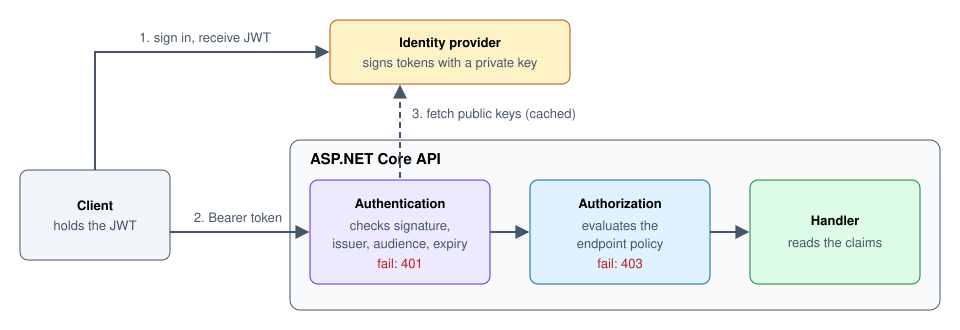

# Authentication and Authorization

Identifying callers and controlling access: JWT bearer tokens, cookies, ASP.NET Core Identity, policies and resource-based checks.

Author

Benedict Thekkel

**Authentication** answers “who is calling?”. **Authorization** answers “what may they do?”. ASP.NET Core keeps these as two separate middleware components. The result of authentication is a `ClaimsPrincipal`, which is a user described by a list of key-value claims.

> **NOTE:**
>
> The code on this page has not been compiled or run yet. It targets .NET 11 and C# 15.

------------------------------------------------------------------------

## 1. How a JWT Request Works



The client gets a token from an identity provider, sends it to the API, and the API validates it before checking the policy

A **JWT** (JSON Web Token) is a signed token that holds claims. The API validates the signature with the public keys of the identity provider, so it does not need a database lookup.

------------------------------------------------------------------------

## 2. Choose a Method

| Client | Recommended method |
|----|----|
| Browser SPA on the same site | HTTP-only cookie |
| Browser SPA with an external identity provider | OIDC with a backend-for-frontend, then a cookie |
| Mobile app or service-to-service | JWT bearer token |
| Server-rendered pages | Cookie |

Do not store long-lived tokens in `localStorage`, because any XSS (cross-site scripting) bug can read them.

------------------------------------------------------------------------

## 3. Validate JWTs

``` bash
dotnet add package Microsoft.AspNetCore.Authentication.JwtBearer
```

``` csharp
using Microsoft.AspNetCore.Authentication.JwtBearer;

builder.Services
    .AddAuthentication(JwtBearerDefaults.AuthenticationScheme)
    .AddJwtBearer(options =>
    {
        options.Authority = builder.Configuration["Auth:Authority"];
        options.Audience = builder.Configuration["Auth:Audience"];
        options.MapInboundClaims = false;
    });

builder.Services.AddAuthorization();

var app = builder.Build();

app.UseAuthentication();
app.UseAuthorization();
```

`Authority` is the identity provider URL. The handler downloads its signing keys automatically. `MapInboundClaims = false` keeps standard claim names such as `sub`, rather than renaming them to long XML-style URIs.

------------------------------------------------------------------------

## 4. Protect Endpoints

``` csharp
using System.Security.Claims;

var items = app.MapGroup("/items").RequireAuthorization();

items.MapGet("/", ListItems).AllowAnonymous();

items.MapGet("/mine", (ClaimsPrincipal user) =>
{
    var userId = user.FindFirstValue("sub");
    return TypedResults.Ok(new { userId });
});
```

Make authentication the default. New endpoints are then protected even when someone forgets to add a rule.

``` csharp
builder.Services.AddAuthorizationBuilder()
    .SetFallbackPolicy(new AuthorizationPolicyBuilder()
        .RequireAuthenticatedUser()
        .Build());
```

Mark public endpoints with `.AllowAnonymous()`.

| Response           | Meaning                                  |
|--------------------|------------------------------------------|
| `401 Unauthorized` | The caller is not authenticated          |
| `403 Forbidden`    | The caller is known but lacks permission |

------------------------------------------------------------------------

## 5. Policies

A **policy** is a named set of requirements. Prefer policies over checks for role names in handlers.

``` csharp
builder.Services.AddAuthorizationBuilder()
    .AddPolicy("admin", policy => policy.RequireRole("admin"))
    .AddPolicy("verified", policy => policy.RequireClaim("email_verified", "true"))
    .AddPolicy("items:write", policy => policy.RequireAssertion(context =>
        context.User.FindFirst("scope")?.Value.Split(' ').Contains("items:write") == true));

items.MapPost("/", CreateItem).RequireAuthorization("items:write");
```

The standard `scope` claim is one space-separated string, so `RequireClaim("scope", "items:write")` fails when a token has several scopes. The assertion above splits the value first.

------------------------------------------------------------------------

## 6. Resource-Based Authorization

A policy on a route cannot check data that the handler has not loaded yet. Use a handler for rules such as “only the owner can edit this item”.

``` csharp
using Microsoft.AspNetCore.Authorization;

public sealed class OwnerRequirement : IAuthorizationRequirement;

public sealed class ItemOwnerHandler : AuthorizationHandler<OwnerRequirement, Item>
{
    protected override Task HandleRequirementAsync(
        AuthorizationHandlerContext context, OwnerRequirement requirement, Item item)
    {
        if (context.User.FindFirst("sub")?.Value == item.OwnerId)
        {
            context.Succeed(requirement);
        }

        return Task.CompletedTask;
    }
}
```

``` csharp
builder.Services.AddSingleton<IAuthorizationHandler, ItemOwnerHandler>();

items.MapPut("/{id:int}", async (
    int id, UpdateItem body, ClaimsPrincipal user,
    IAuthorizationService auth, AppDbContext db, CancellationToken ct) =>
{
    var item = await db.Items.FindAsync([id], ct);
    if (item is null) return Results.NotFound();

    var result = await auth.AuthorizeAsync(user, item, new OwnerRequirement());
    if (!result.Succeeded) return Results.Forbid();

    item.Name = body.Name;
    await db.SaveChangesAsync(ct);
    return Results.NoContent();
});
```

Return `404` instead of `403` when the existence of a record is itself private.

------------------------------------------------------------------------

## 7. ASP.NET Core Identity

**Identity** is the built-in user system. It stores users, password hashes, roles and lockouts in your database. Use it when your app owns its user accounts.

``` bash
dotnet add package Microsoft.AspNetCore.Identity.EntityFrameworkCore
```

``` csharp
using Microsoft.AspNetCore.Identity;
using Microsoft.AspNetCore.Identity.EntityFrameworkCore;

public sealed class AppUser : IdentityUser;

public sealed class AppDbContext(DbContextOptions<AppDbContext> options)
    : IdentityDbContext<AppUser>(options);
```

``` csharp
builder.Services.AddAuthorization();

builder.Services
    .AddIdentityApiEndpoints<AppUser>()
    .AddEntityFrameworkStores<AppDbContext>();

var app = builder.Build();

app.MapGroup("/account").MapIdentityApi<AppUser>();
```

`MapIdentityApi` adds register, login, refresh, password reset and two-factor endpoints. Its bearer tokens are opaque tokens, not JWTs, and only this app can read them.

------------------------------------------------------------------------

## 8. Cookies for a React SPA

``` csharp
builder.Services.ConfigureApplicationCookie(options =>
{
    options.Cookie.HttpOnly = true;
    options.Cookie.SecurePolicy = CookieSecurePolicy.Always;
    options.Cookie.SameSite = SameSiteMode.Lax;

    options.Events.OnRedirectToLogin = context =>
    {
        context.Response.StatusCode = StatusCodes.Status401Unauthorized;
        return Task.CompletedTask;
    };
});
```

An API should return `401`, and this event replaces the default redirect to a login page. Protect cookie-authenticated writes from CSRF (cross-site request forgery) with the antiforgery services.

------------------------------------------------------------------------

## 9. Compared With Django

| Django and DRF | ASP.NET Core |
|----|----|
| `django.contrib.auth` | ASP.NET Core Identity |
| `request.user` | `ClaimsPrincipal` |
| `IsAuthenticated` | `RequireAuthorization()` |
| `AllowAny` | `AllowAnonymous()` |
| `DEFAULT_PERMISSION_CLASSES` | `SetFallbackPolicy` |
| `has_object_permission` | `AuthorizationHandler<TRequirement, TResource>` |
| `simplejwt` | `JwtBearer` for validation, and an identity provider to issue tokens |
| `django-allauth` | External authentication handlers, or an identity provider |

------------------------------------------------------------------------

## 10. Common Mistakes

| Mistake | What goes wrong | Do this instead |
|----|----|----|
| Authorization before authentication | All users are anonymous | Put authentication first |
| No fallback policy | A new endpoint is public by accident | Set `SetFallbackPolicy` |
| Disabling token validation to fix an error | Forged tokens are accepted | Fix the issuer or audience setting |
| Trusting a user ID from the request body | One user can act as another | Read it from the claims |
| Checking only the route, not the record | Users can read each other’s records | Add resource-based authorization |
| Long-lived tokens in `localStorage` | XSS can steal them | Use HTTP-only cookies |

------------------------------------------------------------------------

Back to top
